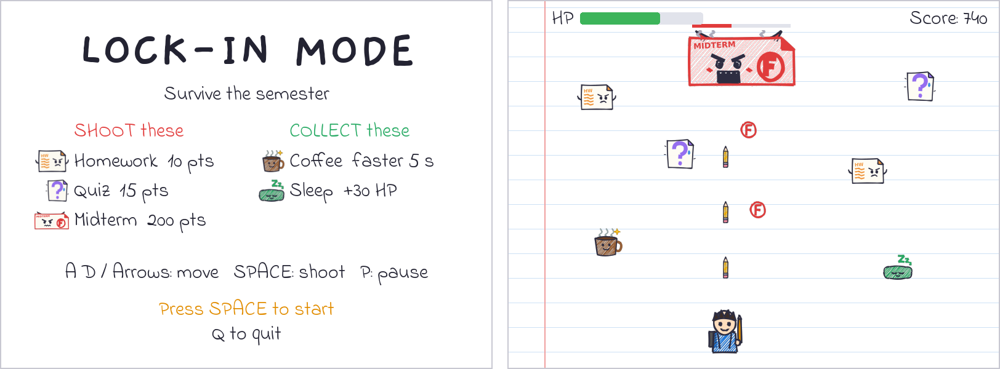

Hi  My name is Chalanthorn Srinaunchan
================================================================================================================================================

Software Engineering student at Thammasat University

* 🌍  I'm based in Bangkok , Thailand
* ✉️  You can contact me via [Email](mailto:tonlism02548@gmail.com)

## Featured Projects

### [Mule Account Detector](https://github.com/enivyus/mule-detector)
**A mini core bank plus a system that catches mule accounts: accounts that receive scam victims' money and pass it on within minutes.**

Built end to end: the bank, a streaming detector, a graph analysis step, auto-freeze, and an investigator dashboard. All data is synthetic.

- **Core banking that keeps its books straight:** Spring Boot + PostgreSQL, double-entry ledger, row locks taken in a fixed order, idempotency keys. 1,000 concurrent transfers still balance to the satang.
- **Real-time detection:** every completed transfer is published to Redpanda (Kafka API). A rule engine scores accounts as money moves and freezes them automatically when 3+ rules fire.
- **Follow the money:** Neo4j graph analysis spreads suspicion along the money trail and groups rings with Louvain community detection.
- **Measured honestly:** thresholds were tuned on one seed and scored once on a seed never seen before.

| | Precision | Recall |
|---|---|---|
| Simple rules (baseline) | 32% | 100% |
| **Rules + graph** | **87%** | **100%** |
| **Auto-freeze tier** | **100%** (0 genuine accounts frozen) | 59% |

- **Live demo result:** 23 accounts frozen (all mules), **89% of the rings' cash-out withdrawals refused**.
- **Secure by role:** Spring Security roles (channel, investigator, rule engine). Every freeze and unfreeze is written to an audit log with who did it and why.
- **Investigator dashboard:** React + Cytoscape.js, Thai/English, light/dark. A "survey map" design: risk drawn as contour rings, stolen money traced as a route across accounts.

`Java 21` `Spring Boot` `PostgreSQL` `Kafka / Redpanda` `Neo4j` `React` `Cytoscape.js` `Python` `Docker`

---

### [Thailand Electricity & Power Generation LCI Database](https://github.com/enivyus/yoursql-electricity-lci) 
**A database of Thai electricity data where every number can be traced back to the exact table row or spreadsheet cell it came from.**

Team project (2 people) for CN230 Database Systems × MTEC, Thammasat University. My role: PM/BA, SQL Lead and QA Lead.

- **Every row is traceable:** each value keeps its source ID, its location in the original file (page, table and row, or Excel cell) and the SHA-256 of the downloaded snapshot. Click any number on the website to see where it came from.
- **A quality gate with no guessing:** 888 rows imported from EPPO statistics and a peer-reviewed LCI study, 870 passed review. Values that cannot be used, such as a misprinted NOx figure, are kept exactly as printed but held out of calculations.
- **A database that protects itself:** SQLite, 9 tables in 3NF, 18 triggers that block any edit to source values, and an append-only history of every status change with who made it and why. The loader checks hashes, headers, units and foreign keys, and rejects the whole batch on a single error.
- **Checked against the source:** all 31 LCI values match the PDF, and fuel-by-fuel totals match the published totals in all 97 year and month groups (largest difference 0.09%).
- **Beyond SQL:** the same data loaded into Neo4j (41 nodes, 33 relationships) gives the same answers as SQL JOINs, and a semantic search prototype (multilingual embeddings + pgvector) scored 2.4/3.

`SQLite` `SQL` `Python` `Neo4j / Cypher` `pgvector` `React` `TypeScript` `Tailwind CSS` `Vercel`

[Live demo website](https://yoursql.vercel.app/)

---

### [Lock-in Mode](https://github.com/enivyus/Lock-in-Mode)
**A doodle-style shooter about surviving the semester: shoot down homework, quizzes and the Midterm boss with pencils before the workload buries you.**

Team project (2 people) for SF211 Object-Oriented Programming, Thammasat University.

- **Built around OOP:** 20 classes in 8 modules. Abstract base classes (`GameObject`, `PowerUp`, `GameState`) define the contract, and one update/draw loop drives every object with no type checks. Adding a new enemy means adding one subclass.
- **Reusable components:** `Health` and `Weapon` are shared by the player, the enemies and the boss, each with its own settings (the boss's gun reloads in 1.2 s, the player's in 0.25 s).
- **State machine on a stack:** Menu, Play, Pause and Game Over. Pause is pushed on top of the game, so the game freezes but stays visible underneath.
- **Event-driven scoring:** collisions post custom Pygame events and a `ScoreManager` observer turns them into a score and a final grade from A to F. The collision code never touches the score.
- **Gets harder every "week":** every 20 seconds enemies spawn faster (down to one every 0.3 s), the boss returns sooner, and from week 6 enemies can arrive in pairs, so every run ends eventually.
- **Hand-drawn look:** notebook-paper background, doodle sprites and handwriting fonts. Every image falls back to a version drawn in code if its file is missing.

`Python` `Pygame-ce` `OOP` `Design patterns`
